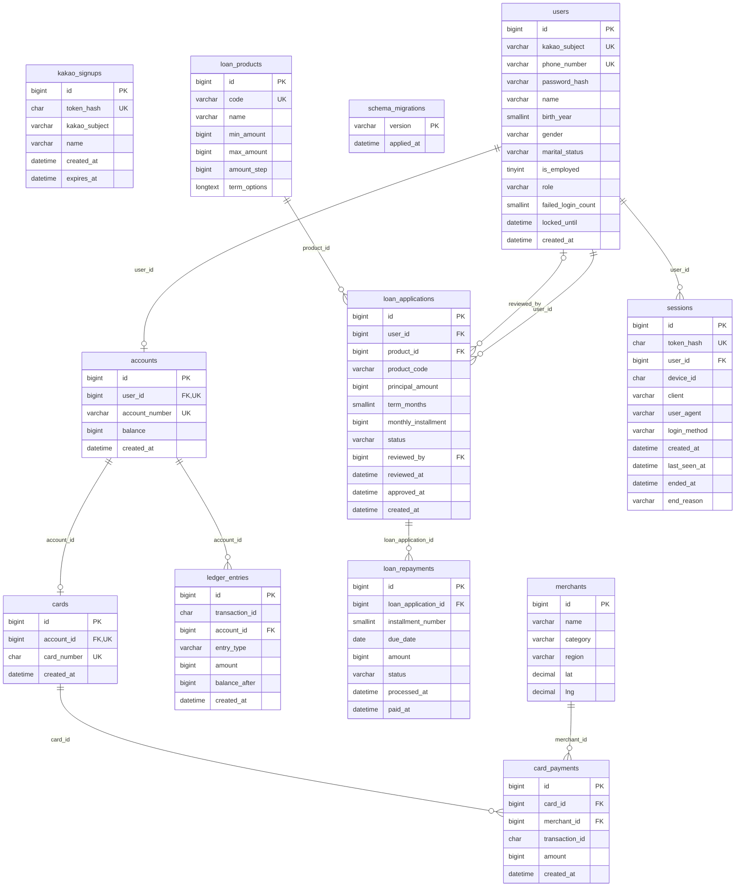

# 포도 뱅킹 시스템의 데이터 수집 & 관찰

> **이 저장소에 대해**: [encore-ai-campus/mlo-03-p1-team3](https://github.com/encore-ai-campus/mlo-03-p1-team3)의 `c0b8758` 커밋을 기준으로, FastAPI 백엔드를 Rust로 옮기는 저장소입니다. 원본 코드와 커밋 기록은 원본 저장소에 있습니다. Rust 서버는 `backend-rs/`, 빌드·테스트 VM 준비는 `lab/`에 있습니다.

---

> **뱅킹 서비스에서 발생하는 거래·이벤트·로그·메트릭을 수집하고, 데이터의 품질과 활용 가능성을 검증하는 프로젝트**
>
> 뱅킹 서비스를 직접 설계하면서 **데이터 발생 → 수집 → 저장 → 검증 → 관측**을 구현하는 프로젝트입니다.

## 1. 프로젝트 소개

---

은행 시스템을 모의 구현해 데이터 발생 환경을 만들고, 데이터를 수집·검증·관측할 수 있는 환경을 구축합니다. 
금융 거래가 정확하게 처리되고, 장애가 발생해도 거래 기록이 유실되지 않는 환경을 구축합니다. 

### 목표

1. **데이터 발생점 구축**: 회원, 입출금, 송금, 카드, 대출 기능을 갖춘 뱅킹 서비스 개발
2. **데이터 수집원**: 업무 DB, 이벤트 DB, 애플리케이션 로그, 시스템 메트릭
3. **데이터 품질 검증**: 누락, 중복, 정합성, 수집 지연 확인
4. **데이터 시각화**: Grafana를 통한 현황 모니터링

## 2. 주요 기능

---

### 2.1 뱅킹 서비스

| 기능 | 주요 내용 |
|---|---|
| 회원 관리 | 회원가입, 로그인, 로그아웃, 회원정보 관리 |
| 입출금 | 계좌 개설, 잔액 조회, 입금 및 출금, 거래 내역 조회 |
| 송금 | 계좌 간 송금, 수취인 관리, 송금 내역 조회 |
| 카드 | 카드 발급, 결제 및 취소, 이용 내역 조회 |
| 대출 | 대출 신청, 심사, 상환, 대출 내역 조회 |

### 2.2 데이터 수집 및 저장

- 사용자 행동 및 금융 거래 이벤트 수집
- MongoDB 기반 이벤트 데이터 저장
- Nginx 및 FastAPI 애플리케이션 로그 수집
- API 성능 및 서버 자원 메트릭 수집
- 데이터 수집 정상 여부 검증

### 2.3 모니터링 및 시각화

- CPU, 메모리 등 서버 자원 사용량
- Grafana 대시보드 구축

## 3. 시스템 아키텍처

---

## 4. erd

---



## 5. 데이터 수집 설계

---

### 5.1 데이터 수집원

| 수집원 | 데이터 종류 | 수집 내용 | 활용 목적 |
|---|---|---|---|
| MariaDB | 정형 데이터 | 회원, 계좌, 거래, 대출 정보 | 금융 거래 데이터 검증 |
| MongoDB | 반정형 데이터 | 사용자 행동 및 금융 이벤트 | 행동 패턴 및 이상거래 분석 |
| Nginx / FastAPI | 로그 데이터 | 요청, 응답, 오류 로그 | 장애 분석 및 요청 추적 |
| Prometheus | 시계열 데이터 | CPU, 메모리, 응답 시간, 요청 수 | 시스템 성능 모니터링 |

### 5.2 데이터 품질 검증

### 5.3 수집 데이터 활용

## 6. 데이터 검증 및 시각화

---

**목표**

- 사용자 행동 이벤트 생성
- 금융 거래 이벤트 생성
- MongoDB 이벤트 저장
- 이벤트 중복 및 누락 검증

**검증**

- 거래 발생 시 이벤트 생성 여부
- 거래 ID와 이벤트 연결 여부
- 이벤트 스키마 일관성

## 6. 기술 스택

---

| 구분 | 기술 | 역할 |
|---|---|---|
| Backend | Python, FastAPI | 뱅킹 API 개발 |
| RDBMS | MariaDB (Master/Slave) | 업무 데이터 저장 및 복제 |
| NoSQL | MongoDB | 사용자 행동 및 금융 이벤트 저장 |
| Web Server | Nginx | 리버스 프록시 |
| Load Balancer | HAProxy | 백엔드 서버 부하 분산 |
| Metrics | Prometheus | 시스템 및 애플리케이션 메트릭 수집 |
| Log Collector | Grafana Alloy | 로그 수집 및 전달 |
| Log Storage | Grafana Loki | 로그 저장 및 조회 |
| Visualization | Grafana | 모니터링 대시보드 |
| Collaboration | Git, GitHub | 버전 관리 및 협업 |

## 11. 실행 및 재현 방법

---

## 12. 회고

---


## Python·Rust 로컬 비교 테스트

원본 동기화 기준: `933070618955507ed7b9f27a5f159fc07c0ecd80`.
기존 포팅 기준 `c0b8758` 이후 변경은 배포·관측·부하 테스트이며, Python 백엔드 변경은 없습니다.

Python API, Rust API, MariaDB 11.4, MongoDB 7.0.45만 Docker Compose로 실행합니다.
상태 확인 API와 없는 경로의 오류 응답을 비교합니다.
MongoDB 중단 시 `200`과 `mongodb: down`, MariaDB 중단 시 `503` 오류,
각 DB 복구 후 정상 응답까지 자동으로 확인합니다. 요청 ID는 UUID 형식과 헤더·본문 일치를 검사합니다.
아래 업무 비교 테스트는 일반 가입·로그인·로그아웃·세션 인증, 계좌·거래 내역 조회,
입출금·받는 사람 조회·송금을 두 서버에 같은 시나리오로 실행합니다.
Python의 API 계약, 세션 만료·로그인 잠금, 계좌 잠금 순서, 거래 경계, 한도와
커밋 후 이벤트 기록을 기준으로 포팅했습니다. 성능 튜닝은 추가하지 않았습니다.
카카오 외부 인증·카드 결제·대출과 프록시를 포함한 부하 비교는 이번 범위가 아닙니다.

```bash
python3 lab/compose/init-env.py
bash lab/compose-test.sh
# 업무 기능·동시성 비교 (실제 MariaDB·MongoDB 사용)
bash lab/business-test.sh
# MongoDB가 중단되어도 금융 거래가 성공하는지 비교 (종료 시 DB 재시작)
bash lab/business-test.sh --faults
```

비밀값은 자동 생성한 `lab/compose/.env`에만 보관합니다. 포트 변경 예시는
`lab/compose/.env.example`에 있습니다. 첫 빌드에는 이미지·패키지 다운로드가 필요합니다.
Rust는 컴파일 작업 4개를 사용하고 디버그 정보를 생략합니다.
실행 컨테이너 메모리 한도는 MariaDB 1GiB, MongoDB 2GiB, Python 1GiB,
Rust 1GiB로 합계 5GiB이며, 이미지 빌드에 필요한 메모리는 별도입니다.
MongoDB 내부 캐시는 512MiB로 제한합니다.
이미지 빌드 단계에서 `cargo test --locked`와 `cargo build --locked`를 실행합니다.
x86에서도 같은 명령을 사용하며 현재 머신의 실행 파일을 복사하지 않습니다.

테스트 후 서버는 계속 실행됩니다. Python은 `http://127.0.0.1:18001`, Rust는
`http://127.0.0.1:18101`에서 접근합니다. DB 포트는 호스트에 공개하지 않습니다.
테스트 중단 시 DB 재시작을 시도하며, DB 데이터는 이 프로젝트 전용 볼륨에 유지합니다.
상태 확인 테스트는 마이그레이션을 실행하지 않습니다. 업무 비교 테스트는 Python의
기존 마이그레이션으로 공통 스키마를 준비하고 테스트용 고객·계좌를 추가합니다.
기존 테이블을 비우지 않으며 테스트 데이터는 남습니다. DB 호스트가 `mariadb`, DB명이
`podobank_test`인 격리된 Compose 구성에서만 업무 테스트를 실행합니다.

업무 테스트는 비밀번호 해시·세션의 양방향 호환, 권한·입력 오류, 성공·실패 이벤트,
잠금 대기 초과, 양방향 동시 송금, 동시 출금, 일일 한도 경합을 검사합니다.
성공 건수와 잔액 변화, 원장 합계, 송금 출금·입금 원장 쌍도 확인합니다.
이 테스트는 기능 비교이며 처리량·지연 수치를 측정하는 부하시험은 아닙니다.

Rust는 기존 개발 빌드를 유지합니다. `sha2 = "0.11.1"`은 Python과 같은 SHA-256
세션 토큰 해시를 저장하기 위해 추가했습니다. 구현 시 확인한 공식 API 문서:
[Axum 추출기·오류 처리](https://github.com/tokio-rs/axum/blob/main/axum/src/docs/extract.md),
[SQLx MySQL 오류 번호](https://docs.rs/sqlx/0.9.0/sqlx/mysql/struct.MySqlDatabaseError.html#method.number),
[Argon2 비밀번호 해시](https://docs.rs/argon2/0.6.0/argon2/).

```bash
# 실행 상태 확인
docker compose --env-file lab/compose/.env ps
# 컨테이너와 네트워크 종료, DB 볼륨 유지
docker compose --env-file lab/compose/.env down
```

기존 VM 배포용 `deploy/` 설정과는 별개입니다. DB가 준비된 뒤 API를 시작하도록
[Compose 공식 문서의 service_healthy](https://docs.docker.com/compose/how-tos/startup-order/)를 사용합니다.

MongoDB는 이전 Podobank Compose와 같은 `7.0.45`를 사용합니다. 이 머신의 Linux
커널 `7.0.0-1013-oracle`에서는 MongoDB 8.0 이미지가 시작 단계에서 종료되었습니다.
[MongoDB 공식 호환성 안내](https://www.mongodb.com/docs/v8.0/release-notes/8.0/)를 참고하세요.
